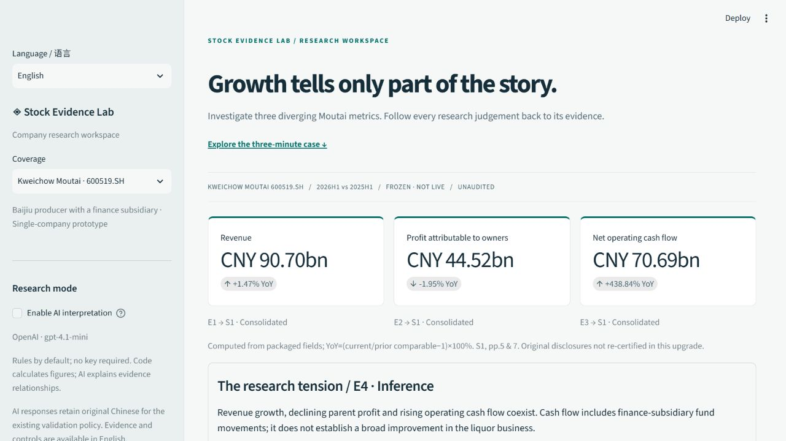

# Stock Evidence Lab · 证据镜

**Trace a research judgement back to its evidence.** A bilingual, single-company financial research prototype built with Python and Streamlit.

[中文说明](#中文说明) · [Three-minute demo](docs/DEMO_V4.md) · [Audit & changes](docs/UPGRADE_V4.md) · [Test report](docs/TEST_REPORT_V4.md) · [Deployment guide](docs/DEPLOY_V4.md)



## The case in one minute

Why do Moutai's revenue, profit and cash flow point in different directions?

| Packaged 2026H1 vs 2025H1 | Year-on-year change | Trace |
|---|---:|---|
| Revenue | +1.47% | E1 → S1, PDF pp.5 & 7 |
| Profit attributable to owners | −1.95% | E2 → S1, PDF pp.5 & 7 |
| Net operating cash flow | +438.84% | E3 → S1, PDF pp.5 & 7 |

These figures are computed from the **existing frozen evidence pack**, not a live feed or newly authenticated filing. Its cash flow explanation includes finance-subsidiary deposit and interbank-fund movements. Strong cash flow alone cannot establish improved liquor-business collections. The product preserves this tension as an **inference**, alongside facts and unknowns.

1. **Investigate:** open the case, generate a rule-based brief, inspect opposing evidence.
2. **Trace:** expand E4 → raw fields, formula, source URL, page locator and recorded SHA-256.
3. **Review:** record your judgement and its rationale or missing evidence; export JSON / Markdown.

Three minutes is a designed presentation path, **not** a measured user or recruiter outcome. No usage, adoption or model-accuracy claims are made.

## Run locally

Python 3.11 is the CI target. Local validation also covers the installed Python 3.10 environment.

```bash
python -m venv .venv
# Windows PowerShell: .\.venv\Scripts\Activate.ps1
# macOS/Linux: source .venv/bin/activate
python -m pip install -r requirements.txt
python -m streamlit run app.py
```

Open the local URL printed by Streamlit. Add `?lang=en` for English or `?lang=zh` for Chinese; the sidebar switch persists the choice in the URL. No API key is required. No external request is made on startup.

## Product decisions

- **Evidence before explanation:** deterministic calculations; explicit fact / inference / unknown labels; disclosure links and locators.
- **Human review:** cite a real source, locator and rationale for support decisions; describe missing material for insufficient evidence. Meaningful research-context changes mark old reviews stale and preserve history. Language changes alone do not invalidate reviews.
- **AI with boundaries:** disabled by default; provider failures are labelled rule fallback. Existing citation, number, event-timing and advice guards remain. They do not prove semantic truth.
- **Bilingual presentation:** English / Chinese evidence, controls, source metadata and readable notes. Canonical JSON records, original filings, AI responses and user-entered text retain their original language. AI prose remains Chinese under the existing validated policy; this release does not claim English model-output validation.
- **Progressive disclosure:** the Moutai case is primary; historical valuation, the two-company peer sample, tasks and CSV validation remain available under research tools.

Review and task state is **session-only**. Export before refreshing or closing. Visual type filters do not remove cited evidence from the full scoped export or review panel.

## Architecture retained

| Module | Responsibility |
|---|---|
| `app.py`, `styles.css` | Streamlit workflow and responsive presentation |
| `presentation.py` | Authored English views; stable evidence IDs, URLs and canonical records |
| `diagnosis.py` | Calculations, data validation, Chinese / English keyword scope |
| `ai_layer.py`, `request_gate.py` | Existing provider integration, validation, caching and request controls |
| `review_records.py` | Existing claim review, fingerprints and stale history |
| `research_export.py` | Chinese / English Markdown from the same research record |

No new frontend framework, database or data provider was added. Frozen data files and original tests are unchanged.

## Verify

```bash
python -m compileall -q app.py diagnosis.py ai_layer.py request_gate.py research_export.py review_records.py presentation.py
python -m unittest discover -s tests -v
python tools/evaluate_analysis.py
python tools/evaluate_boundary_challenge.py
```

See the [current report](docs/TEST_REPORT_V4.md) for exact results, environment and limits. Offline authored cases are validator regressions, not live-model accuracy measurements.

## Optional AI configuration

The app reads environment variables or `.streamlit/secrets.toml`; it does not automatically load `.env`. Keep credentials out of Git.

```toml
AI_PROVIDER = "openai"
OPENAI_API_KEY = "your-server-key"
AI_MODEL = "gpt-4.1-mini"
```

Alternatively, use `AI_PROVIDER="zhipu"` and `ZHIPU_API_KEY`. Existing pinned models and request controls are retained; current provider availability and pricing must be checked before enabling. See [the inherited integration documentation](docs/README_V3_ARCHIVE.md#环境变量与secrets). Questions and public evidence are sent only after AI is enabled and generation is requested; CSV uploads are excluded. Do not enter private information.

## Release & data boundaries

Version **4.0 is a branch deliverable, not a deployed release**. The existing [public app](https://stock-evidence-lab-yiasun.streamlit.app/) was observed asleep during the 2026-11-11 audit. The upgrade has not been deployed or merged into main. [Deployment and rollback](docs/DEPLOY_V4.md) require owner approval and a separate preview app.

The inherited pack records financial periods 2026H1 / 2025H1, verification on 2026-10-16, 27 historical price observations through 2026-10-15, and a two-company peer sample. Reports are unaudited. PDF hashes and prior manual checks are inherited provenance, not a new authentication of those filings. Runtime checks cover packaged field consistency and the historical price file hash. Valuation mixes dated price / shares under an explicit unverified-share-change assumption; it is not official daily PE/PB or a cheap/expensive signal.

No live quotes, automatic filing ingestion, licensed iFinD/Fuyao integration, full-industry ranking, investment advice or return guarantees. See [data provenance](docs/DATA_VERIFICATION.md). Existing [v3 PDF](output/pdf/stock-evidence-lab-report.pdf), screenshots and earlier reports are historical artifacts and do not represent this interface.

## 中文说明

证据镜是可操作的单标的金融研究原型。首页以贵州茅台“营收增长、归母净利润下降、经营现金流大增”的背离为入口，让招聘人员沿“案例 → 原始证据 → 人工复核 → 导出”体验研究闭环。

本次升级保留 Streamlit、确定性计算、原有AI校验和逐主张复核机制，新增双语呈现与英文研究笔记，将行情、估值、同行、清单和CSV沙盒归入研究工具。数据和原有测试保留。所有数字从既有冻结包计算，不新增实时数据或核验声明。

在侧栏切换中文/English；`?lang=en`可直接打开英文体验。AI原始解读保留中文并明确标注，避免将未经校验的翻译当作模型原文。复核历史仅当前会话保存，语言切换不影响已有判定；修改问题或研究上下文会使旧复核失效。

从独立分支开发，未部署、未覆盖线上，也未合并main。完整交付见[修改与审计清单](docs/UPGRADE_V4.md)、[测试报告](docs/TEST_REPORT_V4.md)、[三分钟演示说明](docs/DEMO_V4.md)及[部署步骤](docs/DEPLOY_V4.md)。AI参与了代码、文案和测试编写；候选人应亲自运行并理解产品取舍，不声称已完成真实用户验证。
